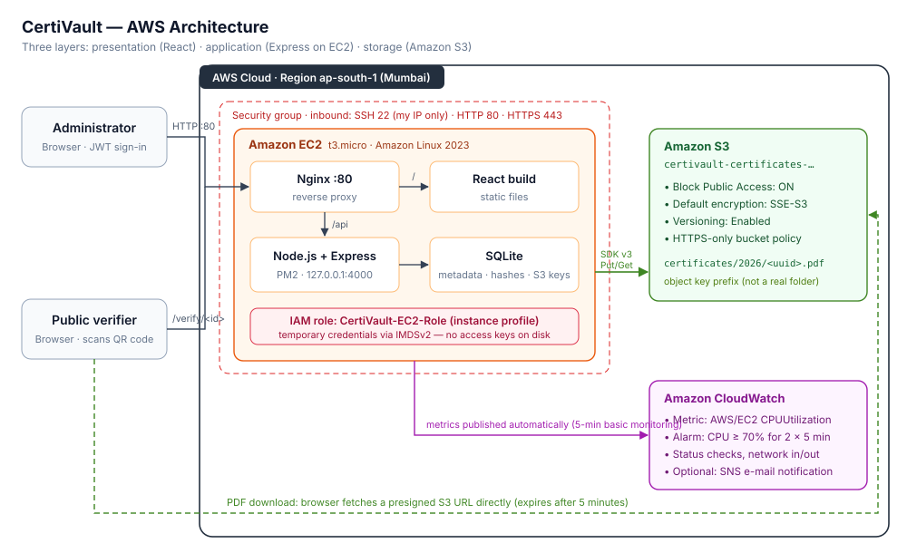
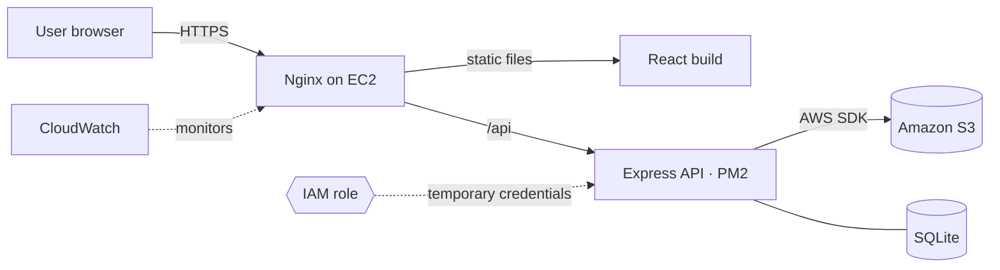

<div align="center">

<h1>CertiVault</h1>


<p><b>Issue, store, and verify digital certificates - securely, on AWS.</b></p>

<p>
CertiVault lets an institution issue tamper-evident certificates, keeps every PDF in a private,
encrypted Amazon S3 bucket, and lets anyone verify authenticity in seconds with a certificate ID or QR code.
The app runs on EC2 and reaches S3 through a least-privilege IAM role 
</p>

<p>
  <a href="https://certivault.27052027.xyz"><b>Live application</b></a> &nbsp;·&nbsp;
  <a href="#system-architecture">Architecture</a> &nbsp;·&nbsp;
  <a href="#key-features">Features</a> &nbsp;·&nbsp;
  <a href="#run-locally">Run locally</a> &nbsp;·&nbsp;
  <a href="#documentation">Docs</a>
</p>

<p>
  
  
  
  
  
</p>

</div>

<br>

## Preview

The application is live at **[certivault.27052027.xyz](https://certivault.27052027.xyz)** over HTTPS. Public pages need no login.

| Page | Route | Access |
|---|---|---|
| Landing page | `/` | Public |
| Verify a certificate (ID, QR link, or PDF upload) | `/verify`, `/verify/<id>` | Public |
| Administrator sign-in | `/admin/login` | Public |
| Dashboard · Issue · Certificates · Details | `/admin`, `/admin/issue`, `/admin/certificates` | Admin |
| Cloud infrastructure status (EC2, S3, IAM) | `/admin/system` | Admin |


<br>

## About the project

Colleges and training organisations issue thousands of certificates, but the process is still manual:

- A PDF on its own proves nothing — certificates can be **forged or edited**.
- **Verification is slow**: employers email or phone the institution.
- Originals get **lost**, and there is **no central record** or way to **revoke** a certificate issued in error.

CertiVault keeps the authoritative record in the cloud:

1. **Issue** — an administrator generates a PDF from a template (with an embedded QR code) or uploads an existing one.
2. **Store** — the PDF goes to a private S3 bucket; metadata, the certificate UUID and a **SHA-256 fingerprint** go to SQLite.
3. **Verify** — anyone opens `/verify/<id>` (or scans the QR code) and sees `VERIFIED`, `REVOKED` or `NOT FOUND`.
4. **Revoke** — an administrator can revoke a certificate with a reason; verification updates immediately.


<br>

## Key features

<table>
<tr>
<th width="50%" align="left">Administrators</th>
<th width="50%" align="left">Public verification (no login)</th>
</tr>
<tr>
<td valign="top">
<ul>
<li>Secure sign-in (bcrypt + JWT) with protected routes</li>
<li>Dashboard: issued / active / revoked / this month, plus a 6-month chart</li>
<li>Issue by <b>generating</b> a PDF (embedded QR) or <b>uploading</b> one</li>
<li>Live certificate preview while filling the form</li>
<li>Search, filter by status, paginate, download, copy link, revoke with reason</li>
<li>Details: S3 key + VersionId, SHA-256, <b>integrity check</b> against S3, PDF preview, QR code</li>
<li>Cloud page with live EC2 metadata, S3 health and the active IAM role</li>
</ul>
</td>
<td valign="top">
<ul>
<li>Verify by <b>certificate ID</b> or by scanning the <b>QR code</b></li>
<li>Clear result: <code>VERIFIED</code>, <code>REVOKED</code> or <code>NOT FOUND</code></li>
<li>Download active certificates through a <b>5-minute presigned S3 URL</b></li>
<li><b>Upload a PDF</b> to check whether it is byte-for-byte identical to an issued certificate</li>
<li>Public responses omit email, storage keys and internal IDs</li>
</ul>
</td>
</tr>
</table>

<br>

## System architecture

<p align="center">
  
</p>



- **Nginx** is the only public entry point. It serves the React build and proxies `/api/*` to Express on `127.0.0.1:4000`.
- **Express** issues and verifies certificates, writes PDFs to **S3**, and keeps metadata in SQLite.
- **IAM role** supplies temporary credentials to the SDK via IMDSv2. **CloudWatch** watches the instance.

Full layer-by-layer description, sequences and database schema: [documentation/architecture.md](documentation/architecture.md).

<br>

## Technology stack

| Layer | Technologies |
|---|---|
| **Frontend** | React 19, Vite, TypeScript, Tailwind CSS v4, React Router, Axios, Lucide icons |
| **Backend** | Node.js 22 LTS, Express 5, TypeScript, AWS SDK for JavaScript v3, Multer, PDFKit, qrcode, zod, jsonwebtoken, bcryptjs, helmet, express-rate-limit |
| **Database** | SQLite (`better-sqlite3`) — metadata only; PDFs are never stored in the database |
| **Cloud** | Amazon EC2, Amazon S3, AWS IAM, Amazon CloudWatch |
| **Server** | Amazon Linux 2023, Nginx (reverse proxy + static hosting), PM2 (process manager) |

<sub>`bcryptjs` is a pure-JavaScript implementation of the same bcrypt algorithm; it avoids native compilation on EC2.</sub>

<br>

## AWS infrastructure

| Service | Purpose | Configuration |
|---|---|---|
| **Amazon EC2** | Hosts Nginx, the React build and the Express API | Amazon Linux 2023, Free-Tier-eligible micro instance, Elastic IP, IMDSv2 |
| **Amazon S3** | Stores every certificate PDF | Private bucket, Block Public Access, SSE-S3 encryption, versioning, HTTPS-only bucket policy, keys `certificates/<year>/<uuid>.pdf` |
| **AWS IAM** | Gives EC2 access to *only* the CertiVault bucket | Role `CertiVault-EC2-Role` with `s3:PutObject` / `s3:GetObject` on `certificates/*` and `s3:ListBucket` — **no access keys** |
| **Amazon CloudWatch** | Monitors the server | EC2 `CPUUtilization` alarm at ≥ 70 % for 10 minutes, optional SNS email |
| **Security group** | Network firewall | SSH 22 from your IP only; HTTP 80 / HTTPS 443 public; backend port 4000 **not** exposed |

Step-by-step console guide: [documentation/aws-setup.md](documentation/aws-setup.md). Policies are in [`infrastructure/aws-policy/`](infrastructure/aws-policy/).

<br>

## Run locally

**Requirements:** Node.js 20.19+ or 22 LTS, and Git.

**1. Clone and install the backend**

```bash
git clone https://github.com/Moukthika6706/certiVault.git
cd certiVault/backend
npm install
cp .env.example .env
```

**2. Configure** — edit `backend/.env` and set `JWT_SECRET`. Keep `STORAGE_DRIVER=local` to run without AWS. Generate a secret with:

```bash
node -e "console.log(require('crypto').randomBytes(48).toString('hex'))"
```

**3. Create an administrator and start the API** (port 4000)

```bash
npm run create-admin -- --name "Admin" --email admin@example.com
npm run dev
```

**4. Start the frontend** in a second terminal (port 5173, proxies `/api` to the backend)

```bash
cd certiVault/frontend
npm install
npm run dev
```

Open **http://localhost:5173**.

> **Local storage is not AWS.** With `STORAGE_DRIVER=local`, PDFs are written to `backend/storage/`. The startup log, the database (`storage_backend = LOCAL`) and an amber banner in the admin UI all say so. Set `STORAGE_DRIVER=s3` to use Amazon S3.

<details>
<summary><b>Environment variables</b> (<code>backend/.env</code> — template in <a href="backend/.env.example"><code>.env.example</code></a>)</summary>

<br>

| Variable | Example | Purpose |
|---|---|---|
| `NODE_ENV` | `production` | Runtime mode |
| `HOST` / `PORT` | `127.0.0.1` / `4000` | API binds to localhost only; Nginx proxies to it |
| `JWT_SECRET` | 96 hex chars | Signs admin sessions and local download tokens (required, min 32 chars) |
| `JWT_EXPIRES_IN` | `8h` | Session lifetime |
| `DATABASE_PATH` | `./database/certivault.db` | SQLite file |
| `PUBLIC_APP_URL` | `https://certivault.27052027.xyz` | Base of verification URLs and QR codes |
| `CORS_ORIGINS` | `https://certivault.27052027.xyz` | Allowed browser origins |
| `TRUST_PROXY` | `true` | Behind Nginx: use `X-Forwarded-For` for rate limiting |
| `STORAGE_DRIVER` | `s3` | `s3` = Amazon S3, `local` = development folder |
| `AWS_REGION` | `ap-south-1` | Bucket region |
| `S3_BUCKET_NAME` | `certivault-certificates-xyz` | Bucket name |
| `MAX_UPLOAD_MB` | `5` | PDF size limit |
| `PRESIGNED_URL_TTL_SECONDS` | `300` | Lifetime of download links |

There are **no AWS access-key variables** by design. The frontend holds no secrets (`VITE_API_BASE_URL` is optional and defaults to `/api`).

</details>

<details>
<summary><b>Test S3 from your laptop</b> (optional)</summary>

<br>

Create an IAM user *only for local testing* with the same policy, run `aws configure --profile certivault`, then:

```bash
export AWS_PROFILE=certivault
```

Set `STORAGE_DRIVER=s3` and `S3_BUCKET_NAME` in `.env`, restart, and run `npm run check-aws`. On EC2 you never do this — the instance role supplies credentials. Delete the user's access key when you are done.

</details>

<details>
<summary><b>Project structure</b></summary>

<br>

```
certiVault/
├── backend/                  Express + TypeScript API
│   ├── src/
│   │   ├── config/           env validation, SQLite connection + schema
│   │   ├── controllers/      auth, certificates, verify, dashboard, system, files
│   │   ├── middleware/       JWT auth, Multer upload, rate limits, error handler
│   │   ├── models/           SQL queries + API mappers
│   │   ├── routes/           REST routes
│   │   ├── services/         certificate workflow, PDF, QR, AWS info,
│   │   │   └── storage/      StorageService → S3StorageService | LocalStorageService
│   │   └── utils/            errors, hashing, validation, logger
│   └── scripts/              create-admin.ts, check-aws.ts
├── frontend/src/             React + Vite + Tailwind (pages, components, context, services)
├── infrastructure/
│   ├── aws-policy/           IAM policy, EC2 trust policy, HTTPS-only bucket policy
│   ├── nginx/                certivault.conf (reverse proxy + SPA routing)
│   └── deployment/           setup-ec2.sh, deploy.sh, ecosystem.config.cjs (PM2)
└── documentation/            architecture, AWS setup, deployment, demonstration
```

</details>

<br>

## Deployment

CertiVault is deployed at **[https://certivault.27052027.xyz](https://certivault.27052027.xyz)** on a single EC2 instance:

| Component | Role |
|---|---|
| **Nginx** | Public entry point on ports 80/443; serves the React build and proxies `/api/*` |
| **PM2** | Keeps the Express API (`certivault-api`) running on `127.0.0.1:4000` and restarts it on failure |
| **Amazon S3** | Private certificate storage, accessed through the instance's IAM role |

Provisioning and releases use the scripts in [`infrastructure/deployment/`](infrastructure/deployment/):

```bash
bash ~/certiVault/infrastructure/deployment/setup-ec2.sh   # one-time: swap, Nginx, Node.js 22, PM2
bash ~/certiVault/infrastructure/deployment/deploy.sh      # build backend + frontend, publish, reload Nginx, restart PM2
```

Set `PUBLIC_APP_URL` and `CORS_ORIGINS` to the HTTPS domain in `backend/.env` so QR codes and verification links point to the live site. The full walkthrough — environment file, admin creation, HTTPS setup, operations and troubleshooting — is in **[documentation/deployment.md](documentation/deployment.md)**.

<br>


## Security highlights

| Area | Decision |
|---|---|
| **Credentials** | No AWS keys in code, `.env` or the frontend. EC2 receives temporary, auto-rotated credentials from its IAM role via IMDSv2. |
| **Least privilege** | The role can only `PutObject` / `GetObject` under `certificates/` and `ListBucket` on one bucket — no delete. |
| **Storage** | Private bucket with Block Public Access, SSE-S3 at rest, HTTPS-only bucket policy and versioning. Files are delivered only via 5-minute presigned URLs. |
| **Transport & network** | Served over HTTPS. Only 80/443 are public, SSH is restricted to one IP, and the API binds to `127.0.0.1` behind Nginx. |
| **Authentication** | bcrypt (cost 12) hashes, JWT sessions, a dummy-hash comparison for unknown emails, login rate limiting. Admins are created only through a server-side script. |
| **Input handling** | zod validation on every write, 5 MB upload limit, PDF signature (`%PDF-`) check, duplicate detection by hash. |
| **Responses** | Public responses omit email, storage keys and internal IDs; unexpected errors return a generic message; helmet headers and strict CORS. |
| **Repository** | `.env`, `*.pem`, databases, uploads and `node_modules` are git-ignored. |

<br>

## Documentation

| Document | Contents |
|---|---|
| [architecture.md](documentation/architecture.md) | Layers, connections, request sequences, database schema, API |
| [aws-setup.md](documentation/aws-setup.md) | Step-by-step AWS Console guide (S3, IAM, EC2, Elastic IP, CloudWatch) |
| [deployment.md](documentation/deployment.md) | EC2 deployment, HTTPS, operations, troubleshooting |
| [demonstration.md](documentation/demonstration.md) | End-to-end demo script and screenshot checklist |

## Future enhancements

- Amazon RDS (PostgreSQL) in place of SQLite — the model layer is already isolated
- CloudWatch Agent for memory and disk metrics, and PM2 logs shipped to CloudWatch Logs
- Amazon SES to email certificates to recipients
- CloudFront in front of the static site
- Bulk issuance from CSV, administrator roles and an audit log
- Infrastructure as Code (CloudFormation or Terraform) for one-command environment creation
