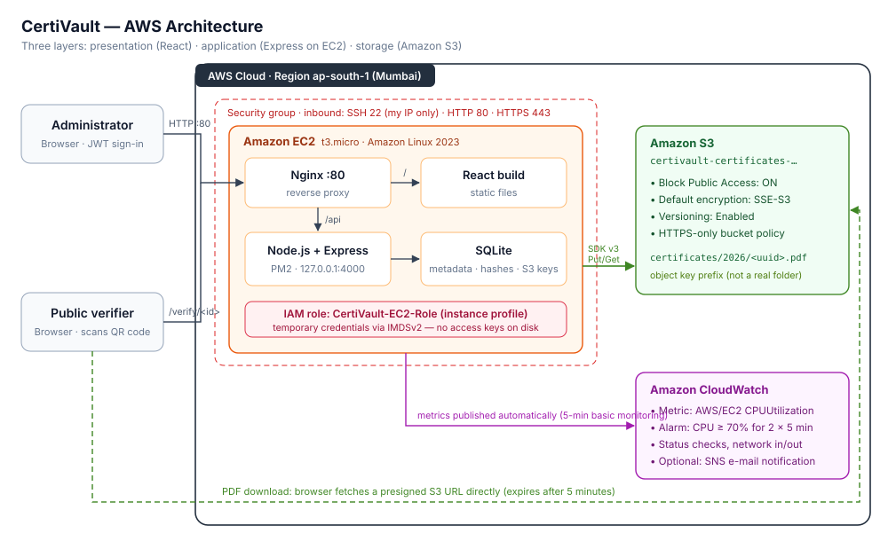
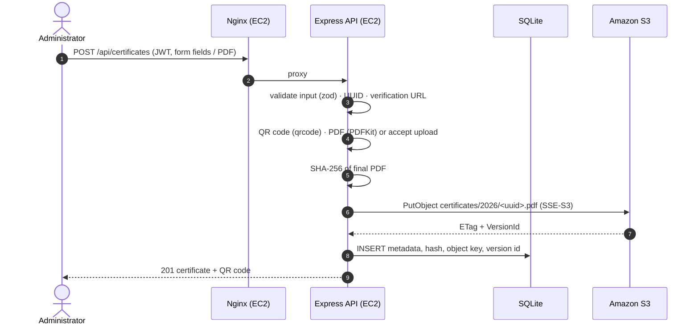
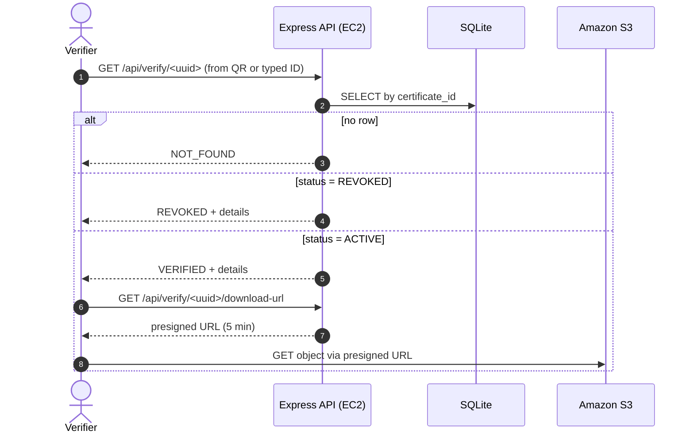

# CertiVault — Architecture



## 1. Layers

| Layer | Technology | Runs on | Responsibility |
|---|---|---|---|
| Presentation | React 19, Vite, TypeScript, Tailwind CSS | Static files served by Nginx on EC2 | Landing page, public verification, admin dashboard, issuance, management |
| Application | Node.js 22, Express 5, TypeScript | EC2, kept alive by PM2, bound to `127.0.0.1:4000` | Auth (JWT + bcrypt), PDF + QR generation, SHA-256 hashing, verification, revocation, S3 access |
| Storage | Amazon S3 (files), SQLite (metadata) | S3 bucket / EC2 EBS volume | PDFs in a private, encrypted, versioned bucket; metadata in SQLite |

## 2. Every connection, explained

| # | From → To | Protocol / mechanism | Why |
|---|---|---|---|
| 1 | Browser → **Nginx** (EC2 :80) | HTTP (HTTPS :443 if a domain + certificate is added) | The only public entry point. The security group allows 80/443 from anywhere and 22 only from your IP. |
| 2 | Nginx → React build | Local files in `/var/www/certivault` | `/`, `/verify/<id>`, `/admin/...` all return `index.html`; React Router renders the page. |
| 3 | Nginx → **Express** | Reverse proxy to `127.0.0.1:4000` for `/api/*` | The backend port is never opened in the security group. Nginx adds `X-Forwarded-For` so rate limiting sees real client IPs. |
| 4 | Express → **SQLite** | `better-sqlite3`, file `backend/database/certivault.db` | Stores certificate metadata, status, SHA-256 hash and the S3 object key. Never stores PDF bytes. |
| 5 | Express → **IMDSv2** (169.254.169.254) | HTTP inside the instance | The AWS SDK's default credential chain fetches **temporary credentials of the attached IAM role**. No access keys exist on the server. |
| 6 | Express → **Amazon S3** | AWS SDK for JavaScript v3 over HTTPS | `PutObject` on issuance, `GetObject` for integrity checks, `HeadBucket` for health. Permissions are limited by the IAM role policy. |
| 7 | Browser → **Amazon S3** (download) | Presigned `GetObject` URL, valid 5 min | The backend signs a short-lived URL; the browser downloads directly from S3. The bucket itself stays private. |
| 8 | EC2 → **CloudWatch** | Built-in hypervisor metrics | CPU, network and status checks are published every 5 minutes at no extra cost; an alarm watches CPU. |

## 3. Issuance sequence



## 4. Verification sequence



**Why the database decides, not the QR code.** A QR code is just a URL — anyone can print one. Authenticity comes from the record held by CertiVault. Likewise, a SHA-256 hash only proves something when a file is re-hashed and compared with the stored value; CertiVault does this in two places:

- **Stored-file integrity check** — downloads the object from S3, hashes it, compares with the hash saved at issuance.
- **Upload-a-PDF check** — hashes a file the verifier has and looks the hash up. Any edit (even re-saving) changes the hash and returns *No matching certificate*.

## 5. Database schema

```sql
admins (
  id INTEGER PK, name TEXT, email TEXT UNIQUE NOCASE, password_hash TEXT (bcrypt), created_at TEXT
)

certificates (
  id INTEGER PK,
  certificate_id TEXT UNIQUE,            -- UUID v4, public identifier
  recipient_name, recipient_email, certificate_title, course_name,
  issuing_organization, issue_date, description,
  source  TEXT CHECK IN ('GENERATED','UPLOADED'),
  status  TEXT CHECK IN ('ACTIVE','REVOKED') DEFAULT 'ACTIVE',
  storage_backend TEXT CHECK IN ('S3','LOCAL'),   -- honest record of where the file lives
  s3_object_key TEXT, storage_version_id TEXT,     -- S3 key + VersionId returned by PutObject
  sha256_hash TEXT, file_size_bytes INTEGER,
  verification_url TEXT, issued_by INTEGER → admins.id,
  revocation_reason TEXT, created_at, updated_at, revoked_at
)
-- indexes: status, recipient_name (NOCASE), sha256_hash, created_at
```

`NOT_FOUND` is never stored — the API generates it when no row matches.

All SQL lives in `backend/src/models/`, so moving to PostgreSQL / Amazon RDS later means re-implementing those two model files and `config/database.ts` only.

## 6. Storage adapters

`backend/src/services/storage/` defines a `StorageService` interface with two implementations:

- `S3StorageService` — the real AWS implementation (`STORAGE_DRIVER=s3`).
- `LocalStorageService` — **development only** (`STORAGE_DRIVER=local`). Files go to `backend/storage/`. The API, the database (`storage_backend = 'LOCAL'`), the startup log and an amber banner in the admin UI all state clearly that this is *not* Amazon S3.

## 7. API endpoints

| Method | Path | Auth | Purpose |
|---|---|---|---|
| GET | `/api/health` | – | Liveness + current storage backend |
| POST | `/api/auth/login` | – (rate-limited 10 / 15 min) | Returns JWT |
| GET | `/api/auth/me` | JWT | Current administrator |
| GET | `/api/dashboard/stats` | JWT | Totals, monthly counts, recent certificates |
| GET | `/api/system` | JWT | Live EC2 metadata, S3 health, IAM caller identity |
| GET | `/api/certificates?search=&status=&page=&pageSize=` | JWT | Search / filter / paginate |
| POST | `/api/certificates` | JWT | Issue (multipart: fields, `mode=generate|upload`, optional `file`) |
| GET | `/api/certificates/:id` | JWT | Full record + QR code data URL |
| GET | `/api/certificates/:id/download-url?disposition=inline|attachment` | JWT | Presigned URL |
| GET | `/api/certificates/:id/integrity` | JWT | Re-hash stored object, compare |
| PATCH | `/api/certificates/:id/revoke` | JWT | Revoke (optional `reason`) |
| GET | `/api/verify/:id` | – (60 / min) | `VERIFIED` / `REVOKED` / `NOT_FOUND` |
| GET | `/api/verify/:id/download-url` | – (60 / min) | Presigned URL, ACTIVE certificates only |
| GET | `/api/verify/:id/integrity` | – (60 / min) | Public integrity check |
| POST | `/api/verify/file` | – (60 / min) | Upload a PDF → hash lookup |
| GET | `/api/files/:token` | signed token | Local-dev storage only (stand-in for presigned URLs) |
